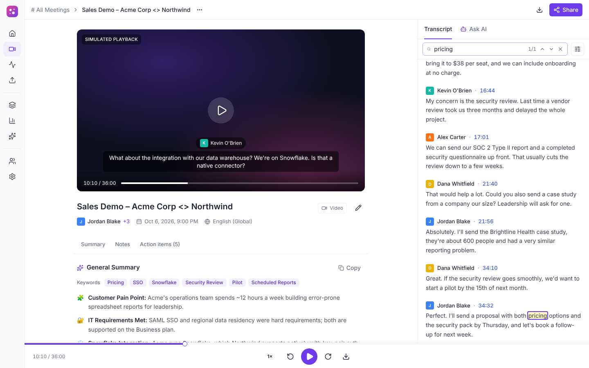
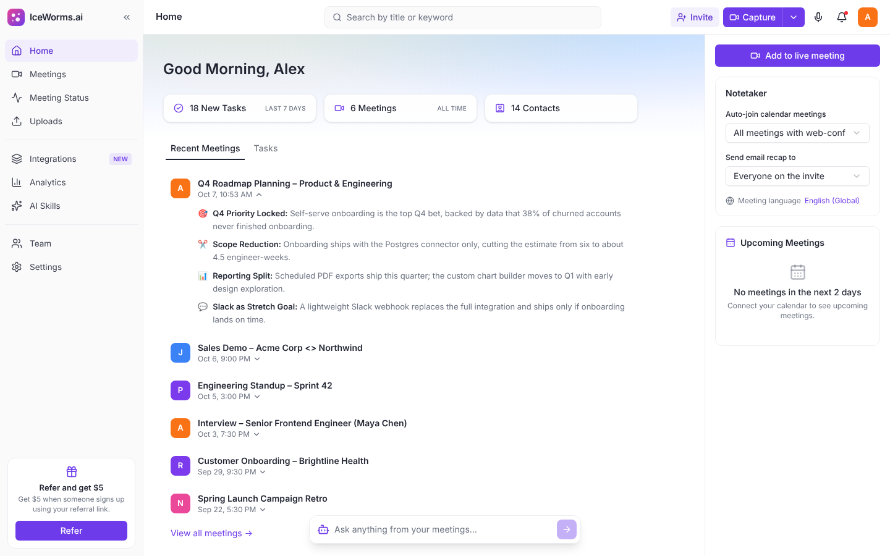
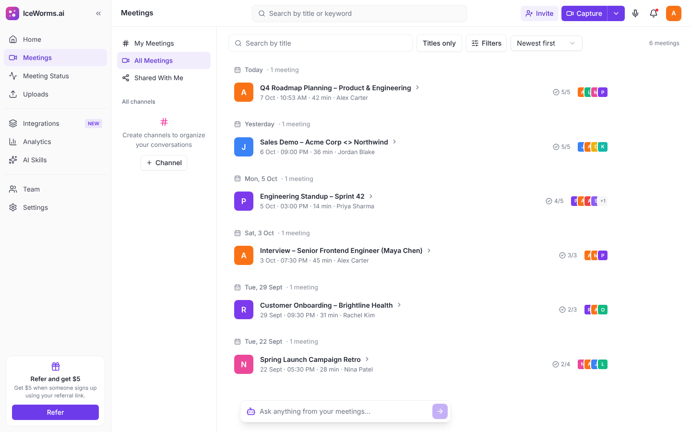
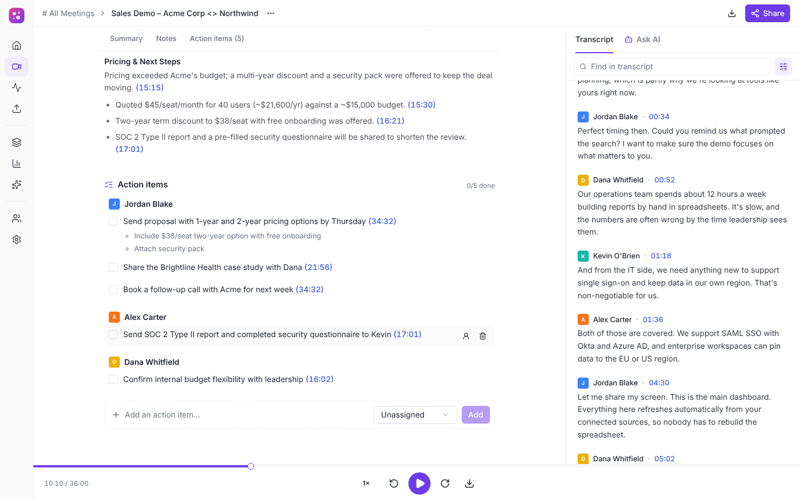
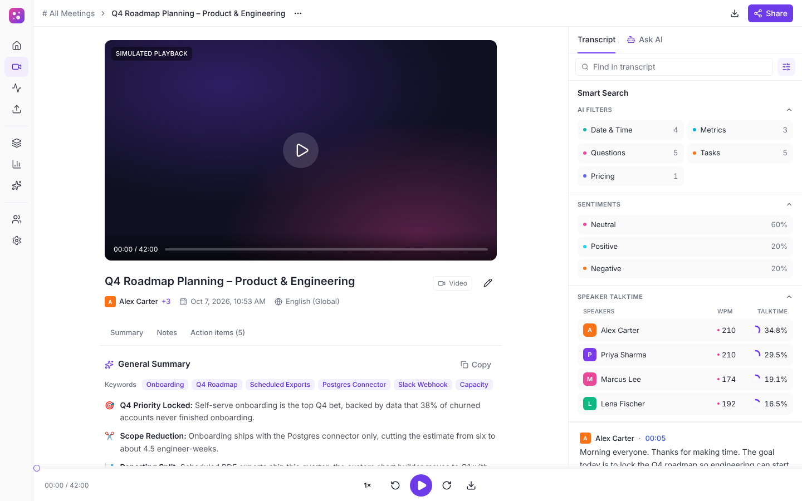
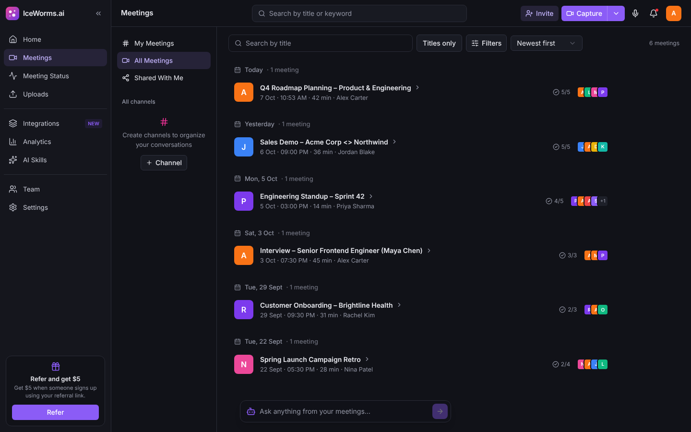
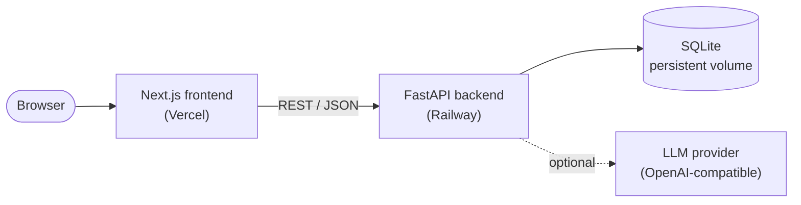
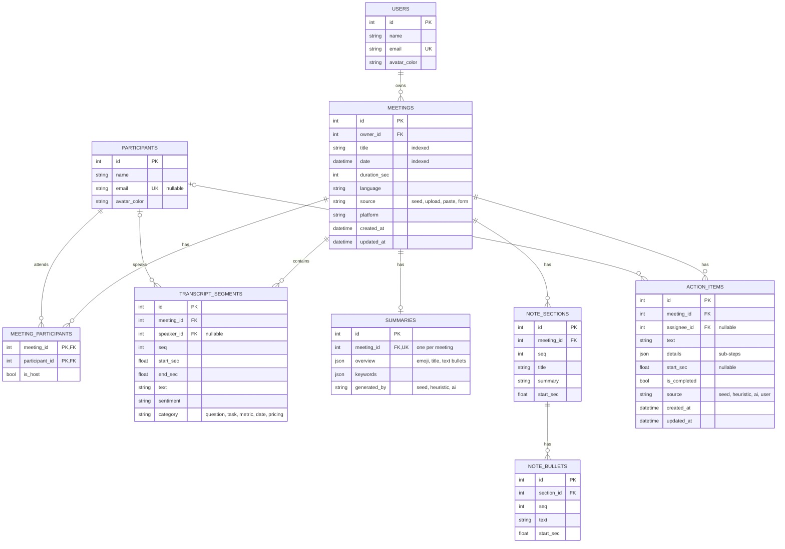

# IceWorms.ai

**A Fireflies.ai-style meeting workspace**: browse meetings, follow interactive transcripts synced to a player, read AI summaries and action items, and ask questions about any meeting.

Built for the Scaler SDE Fullstack assignment (*Fireflies.ai clone*) with **Next.js**, **FastAPI** and **SQLite**.

| | |
|---|---|
| 🌐 **Live app** | https://ice-worms-ai.vercel.app |
| 📘 **API docs** (Swagger) | https://iceworms-ai-production.up.railway.app/docs |
| 💻 **Source** | https://github.com/Diraq-Girach/IceWorms-ai |



---

## Contents
- [Try it in 2 minutes](#try-it-in-2-minutes)
- [Feature checklist](#feature-checklist)
- [Screenshots](#screenshots)
- [Tech stack](#tech-stack)
- [Architecture overview](#architecture-overview)
- [Database schema](#database-schema)
- [API overview](#api-overview)
- [Running locally](#running-locally)
- [Deployment](#deployment)
- [Assumptions & scope](#assumptions--scope)

---

## Try it in 2 minutes

The live app is seeded with six realistic meetings (a sales demo, a roadmap planning session, a standup, an interview, a customer onboarding and a retro).

1. **Meetings library:** search titles, switch to *Titles + transcripts* and search `snowflake`, or use **Filters** to filter by participant or date.
2. **Open "Sales Demo – Acme Corp <> Northwind".**
   - Click any transcript line: the player jumps there and the line highlights.
   - Press ▶ (try 2×): the highlight follows playback and the transcript auto-scrolls.
   - Click any blue timestamp in the **Notes** or **Action items** to seek.
3. **Search inside the transcript:** type `pricing` in *Find in transcript* and step through the highlighted matches.
4. **Smart Search** (sliders icon): filter lines by AI category (questions, pricing…), sentiment or speaker, and see talk-time per speaker.
5. **Ask AI** tab: ask *"What objections came up?"* The answer cites moments like `[15:30]`; click one to jump there.
6. **Generate with AI:** rewrites the summary, notes and action items from the transcript with an LLM.
7. **Action items:** add one, tick it, click its text to edit it, or reassign or delete it.
8. **Create a meeting:** **Capture ▾ → Paste transcript** (or **Uploads**, using a file from [`backend/sample_transcripts/`](backend/sample_transcripts)). Notes and action items are generated automatically.
9. **Edit or delete** a meeting from its **···** menu, **download** a transcript or summary (⬇ in the player bar), and switch to **dark mode** from the avatar menu.

> The live AI runs on Groq's free tier. If you see *"rate limit reached"*, wait a minute. Without an API key the app still works fully and uses rule-based notes instead.

---

## Feature checklist

### Core features

| Requirement | Status | Where |
|---|:-:|---|
| **Meetings library:** title, date, duration, participants | ✅ | `/meetings`, grouped by day like Fireflies |
| Search & filter by title, date, participant; sort by recency | ✅ | Search box, **Filters**, sort menu (newest / oldest / longest) |
| Navbar with profile / settings | ✅ | Top bar: search, Capture, notifications, profile menu; `/settings` |
| **Interactive transcript** with speaker labels & timestamps | ✅ | Right panel of the meeting page |
| Media player area with seek bar | ✅ | Video area + bottom player bar (simulated playback, 0.75×–3×, ±15 s) |
| Click a line → player seeks, **and vice versa** | ✅ | Active line highlights and auto-scrolls during playback |
| Search within transcript with highlighted matches | ✅ | *Find in transcript* with match counter and ↑/↓ navigation |
| **AI summary** | ✅ | General Summary + keywords |
| **Action items** extracted from the meeting | ✅ | Grouped by assignee, each linked to its timestamp |
| Key topics / outline / chapters | ✅ | **Notes** section (chapters with timestamped bullets) |
| **Create** a meeting by upload, paste or form | ✅ | Capture menu; Uploads page (`.txt`, `.vtt`, `.json`, `.srt`) |
| **Edit** meeting metadata (title, participants) | ✅ | Edit dialog (title, date, participants with emails) |
| **Delete** a meeting | ✅ | With confirmation; cascades to its transcript, notes and tasks |
| **Add / edit / complete** action items | ✅ | Inline on the meeting page; also on Home → Tasks |
| Everything **persists** | ✅ | SQLite on a persistent volume in production |
| Fireflies look & feel: layout, panels, modals, filters, **toasts**, settings placeholders | ✅ | See [screenshots](#screenshots) |

### Bonus features

| Bonus | Status | Notes |
|---|:-:|---|
| LLM "ask a question about this meeting" chat | ✅ | **Ask AI** tab with clickable timestamp citations and follow-up questions |
| Export transcript or summary | ✅ | TXT, Markdown, JSON (optionally with timestamps) |
| Global search across all meetings | ✅ | Top-bar search looks inside every transcript |
| Dark mode | ✅ | Light / dark / system |
| LLM-generated summaries | ✅ | Any OpenAI-compatible provider; rule-based fallback |
| Tags / topics filtering | ➖ | Keywords are shown per meeting, not filterable |
| Comments / highlights / soundbites | ➖ | Not implemented |

### Placeholders ("Coming soon")
Live meeting bot, real speech-to-text, integrations, team sharing, channels, analytics, AI skills, real authentication (a default user, *Alex Carter*, is always signed in).

---

## Screenshots

| Home | Meetings library |
|---|---|
|  |  |
| **Notes & action items** | **Smart Search** |
|  |  |
| **Dark mode** | |
|  | |

---

## Tech stack

| Layer | Technology |
|---|---|
| Frontend | Next.js 16 (App Router), TypeScript, Tailwind CSS v4, shadcn/ui (Radix), lucide icons, sonner, next-themes |
| Backend | Python 3.12, FastAPI, SQLModel (SQLAlchemy + Pydantic), httpx |
| Database | SQLite |
| AI (optional) | Any OpenAI-compatible chat API. Live demo: Groq, `openai/gpt-oss-20b` |
| Testing | pytest (32 API tests; AI tests use a fake provider) |
| Hosting | Vercel (frontend), Railway with a persistent volume (backend) |

---

## Architecture overview



- **Frontend:** pages under `app/`, reusable components under `components/`, and a typed API client (`lib/api.ts`, `lib/types.ts`) mirroring the backend's schemas. The player clock and transcript sync live in `lib/use-player.ts`.
- **Backend:** layered as routers (HTTP) → services (business logic) → SQLModel models. Services cover transcript parsing, the summarizers (LLM and rule-based), analytics and participant matching.
- **AI:** optional and isolated in `services/llm.py` and `services/ai.py`. Without a key the app uses the rule-based summarizer.
- **Data:** seeded on first start, so the app is usable immediately.

<details>
<summary><b>Repository layout</b></summary>

```
backend/
  app/
    main.py              app setup, CORS, routers
    models.py            database tables (SQLModel)
    schemas.py           API request/response models
    routers/             meetings, action items, AI, misc
    services/            parsing, summarizers, AI, analytics, business logic
    seed/                seed data (6 meetings) + loader
  tests/                 pytest suite
  sample_transcripts/    example .txt / .vtt / .json uploads
frontend/
  src/app/               pages: home, meetings, meeting detail, uploads, settings…
  src/components/        layout, meetings, meeting (player, transcript, notes, Ask AI), ui
  src/lib/               API client, types, hooks, formatting, export
docs/screenshots/
```
</details>

---

## Database schema



- **Relationships:** meetings ↔ participants is many-to-many (`meeting_participants`), which is what makes *filter by participant* possible. A meeting has at most one summary.
- **Integrity:** deleting a meeting **cascades** to its transcript, summary, notes, action items and participant links. Deleting a participant sets speaker and assignee references to `NULL`, so transcripts and tasks survive. Foreign keys are enforced (`PRAGMA foreign_keys=ON`).
- **Indexes:** `meetings.date` (sorting), `meetings.title` (search), `transcript_segments (meeting_id, seq)` (ordered reads).
- **Derived data isn't stored:** speaker talk-time, words per minute and sentiment percentages are computed from transcript segments when requested.

---

## API overview

Base URL: `/api`. Interactive docs are at [`/docs`](https://iceworms-ai-production.up.railway.app/docs).

| Method | Endpoint | Description |
|---|---|---|
| `GET` | `/meetings` | List meetings. Query: `q`, `scope` (`title` \| `all` = also search transcripts), `participant_id`, `date_from`, `date_to`, `sort` (`newest` \| `oldest` \| `longest`), `limit`, `offset` |
| `POST` | `/meetings` | Create a meeting from a form, optionally with a pasted transcript |
| `POST` | `/meetings/upload` | Create from a transcript file (`.txt`, `.vtt`, `.json`, `.srt`; max 2 MB) |
| `GET` | `/meetings/{id}` | Meeting with participants, summary, notes and action items |
| `PATCH` | `/meetings/{id}` | Edit title, date or participants |
| `DELETE` | `/meetings/{id}` | Delete a meeting and everything in it |
| `GET` | `/meetings/{id}/transcript` | Transcript lines with speaker, sentiment and category |
| `GET` | `/meetings/{id}/analytics` | Talk-time and WPM per speaker, sentiment mix, category counts |
| `POST` | `/meetings/{id}/action-items` | Add an action item |
| `PATCH` | `/action-items/{id}` | Edit text or assignee, complete or reopen |
| `DELETE` | `/action-items/{id}` | Delete an action item |
| `GET` | `/action-items` | Action items across all meetings (Home → Tasks). Query: `completed`, `assignee_id` |
| `POST` | `/meetings/{id}/summary/regenerate` | Regenerate notes with AI (keeps action items people added, edited or completed) |
| `POST` | `/meetings/{id}/ask` | Ask about a meeting → `{ answer, citations }` |
| `GET` | `/ai/status` | Whether AI is configured |
| `GET` | `/me`, `/stats`, `/participants` | Current user, home-page counts, contacts |

Errors return `{"detail": "..."}` with standard status codes (`404`, `413`, `415`, `422`, and `502` / `503` for AI provider errors or missing AI configuration).

---

## Running locally

**Prerequisites:** Python 3.11+, Node.js 20+

**Backend** (http://localhost:8000)
```bash
cd backend
python -m venv .venv
source .venv/bin/activate          # Windows: .venv\Scripts\activate
pip install -r requirements.txt
cp .env.example .env               # Windows: copy .env.example .env
uvicorn app.main:app --reload --port 8000
```
The database is created and seeded on first start. To reset the demo data: `python -m app.seed.seed --reset`.

**Frontend** (http://localhost:3000)
```bash
cd frontend
npm install
cp .env.example .env.local         # Windows: copy .env.example .env.local
npm run dev
```

**Tests**
```bash
cd backend
pip install -r requirements-dev.txt
python -m pytest -q
```

**Environment variables** (backend, all optional locally)

| Variable | Purpose |
|---|---|
| `LLM_API_KEY` | Enables AI features. Leave empty to use rule-based notes |
| `LLM_BASE_URL`, `LLM_MODEL` | Any OpenAI-compatible provider (defaults in `.env.example` are for Groq) |
| `LLM_REASONING_EFFORT`, `LLM_MAX_TOKENS` | Tuning for reasoning models such as `gpt-oss` |
| `DATABASE_PATH` | SQLite file location (production: `/data/app.db` on the volume) |
| `CORS_ORIGINS` | Extra allowed frontend origins (`*.vercel.app` is allowed by default) |

The frontend needs one variable: `NEXT_PUBLIC_API_URL` (the backend URL).

**Transcript formats** for upload or paste: `[00:01:23] Name: text`, `Name: text`, WebVTT, or JSON (`[{"speaker", "start", "end", "text"}]`). Speakers become meeting participants automatically.

---

## Deployment

| Part | Platform | Setup |
|---|---|---|
| Backend | **Railway** | Root directory `/backend`, config file `/backend/railway.json`, volume mounted at `/data`, variables `DATABASE_PATH=/data/app.db` plus the `LLM_*` settings |
| Frontend | **Vercel** | Root directory `frontend`, variable `NEXT_PUBLIC_API_URL=<Railway URL>` |

Both redeploy automatically on every push to `main`.

---

## Assumptions & scope

- **No speech-to-text.** Meetings come from seeded data, uploaded transcript files or pasted text, as the assignment allows.
- **Simulated playback.** There's no audio file; the player runs a clock over the meeting's length, which drives seeking and transcript sync.
- **AI is optional.** With an API key, notes and Q&A use an LLM. Without one, or if the provider fails, notes come from a rule-based summarizer. Sentiment and transcript categories always come from a lightweight rule-based tagger.
- **Single default user.** Authentication is mocked; *Alex Carter* is always signed in.
- **People are matched by email, otherwise by name** (case-insensitive) across meetings.
